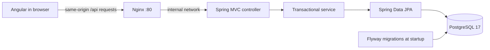

# Architecture

## Request flow

In host development, Angular's proxy replaces Nginx. The API has no broad CORS configuration because both paths use a same-origin proxy.

## Code organization

`backend/src/main/java/dev/servicedesk/request` contains the request feature: DTOs, controller, service, entity, and repository. `config` contains the injected UTC clock and exception translation. The frontend keeps HTTP contracts in `request-api.service.ts` and presentation/form state in the standalone root component. Split presentation components as the UI grows.

The controller validates the HTTP boundary. The service owns transactions and normalization. The repository owns persistence. Entities stay behind response DTOs so changing a database field does not silently change the API.

## Decisions

| Decision | Reason | Tradeoff |
| --- | --- | --- |
| One backend and one frontend | Small enough to understand, deploy, and test as a junior | Split only if concrete requirements justify it |
| PostgreSQL for development and integration tests | Tests exercise real SQL constraints, UUIDs, timestamps, and migrations | Integration tests require Docker |
| Flyway + Hibernate `validate` | Schema changes are explicit, reviewable SQL; startup catches mapping mismatch | Each schema change needs a new migration |
| JPA `@Version` | Concurrent writes detected by Hibernate return HTTP 409 | Does not detect a stale browser overwrite after another transaction has already completed; version/ETag preconditions are a future milestone |
| Inject `Clock` | Deterministic timestamp tests without sleeps | One small configuration bean |
| Stable pagination sort by creation time and UUID | Requests with equal timestamps have deterministic order | Offset pages can shift while new requests arrive |
| Literal title search | `%`, `_`, and `\` are treated as user text, not SQL wildcards | Substring search needs a trigram index if data grows large |
| Any status can move to any other status | Supports reopening a request without extra workflow | Add explicit transition rules if user research calls for them |
| Angular 21 LTS, Java 21, Spring Boot 4 | A supported Angular line and a common Java LTS baseline | Versions need periodic maintenance |
| No Lombok | New contributors can see the Java code and constructors directly | A little more boilerplate |

## Database

`service_requests`: UUID primary key; title (120), description (4,000), priority and status strings with CHECK constraints; creation/update timestamps with time zones; numeric optimistic-lock version. Indexes support newest-first ordering and status filtering. Hibernate initializes version and the service initializes UUID/timestamps.

Never edit `V1` after a database has applied it. Add `V2__description.sql` for subsequent changes. Flyway detects checksum changes; deleting data is not a migration strategy.

## Containers

The backend compiles with Maven and Java 21, then runs from a smaller JRE image as a non-root user. The frontend builds with Node and pnpm, then serves static files through Nginx. PostgreSQL has a persistent named volume. Health checks gate startup in database → backend → frontend order.

Application dependency versions and the pnpm lockfile are committed. Base image tags track their selected major versions; full image digest pinning is a future reproducibility improvement. Backend image compilation skips tests because separate test jobs perform validation; a successful image build alone is not a test result.

## Deliberate first-release limits

No accounts, roles, organization isolation, assignments, comments, audit history, deletion, notifications, attachment uploads, or public deployment yet. Status changes are last-write-wins outside overlapping JPA transactions. Server-side idempotency keys are not implemented; UI protection prevents double clicks during one in-flight submission. Full browser E2E and keyboard/screen-reader review remain planned.
